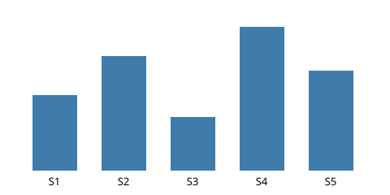
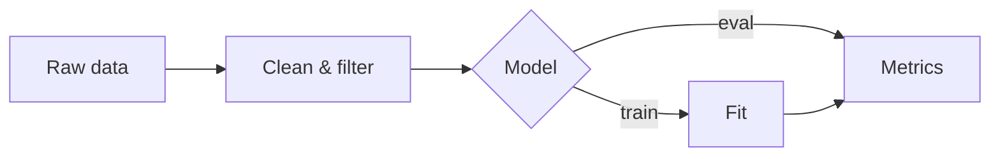

> [!SUMMARY] TL;DR
> This site renders anything pushed to `reports/`. This page demonstrates every supported element so you can check how it looks on your phone.

## Key findings

1. Markdown with **GitHub-flavored** extensions renders cleanly.
2. Tables scroll horizontally on small screens and are **sortable** (tap a header).
3. Charts, math and diagrams render client-side.

> [!FINDING] Main result
> Treatment S4 outperformed baseline by **+38%** ($p < 0.01$).

> [!CAVEAT]
> Sample sizes are small; replicate before drawing conclusions.

## Results table

| Sample | n | Mean | Std | Δ vs. baseline |
|---|---:|---:|---:|---:|
| S1 | 12 | 3.1 | 0.4 | — |
| S2 | 12 | 4.7 | 0.6 | +52% |
| S3 | 10 | 2.2 | 0.3 | −29% |
| S4 | 14 | 5.9 | 0.8 | +90% |
| S5 | 11 | 4.1 | 0.5 | +32% |

## Chart

```chart
{
  "type": "line",
  "title": "Validation loss by epoch",
  "caption": "Figure 2. Both runs converge; run B is ~15% lower at epoch 10.",
  "data": {
    "labels": [1,2,3,4,5,6,7,8,9,10],
    "datasets": [
      { "label": "Run A", "data": [2.1,1.6,1.3,1.1,0.98,0.91,0.86,0.83,0.81,0.80] },
      { "label": "Run B", "data": [2.0,1.4,1.1,0.93,0.82,0.76,0.72,0.70,0.69,0.68] }
    ]
  }
}
```

## Figure



## Math

The estimator minimizes

$$
\hat\theta = \arg\min_\theta \sum_{i=1}^n \left(y_i - f_\theta(x_i)\right)^2 + \lambda \lVert \theta \rVert_2^2
$$

## Method diagram



## Inline CSV

```csv
gene,log2FC,padj
BRCA1,2.31,0.0004
TP53,-1.12,0.012
MYC,3.05,0.00001
EGFR,0.44,0.31
```

## Code

```python
import numpy as np
x = np.linspace(0, 1, 100)
print(x.mean())
```

<details>
<summary>Raw logs (collapsed)</summary>

Long appendix material can go inside `<details>` so it stays out of the way on mobile.

</details>
