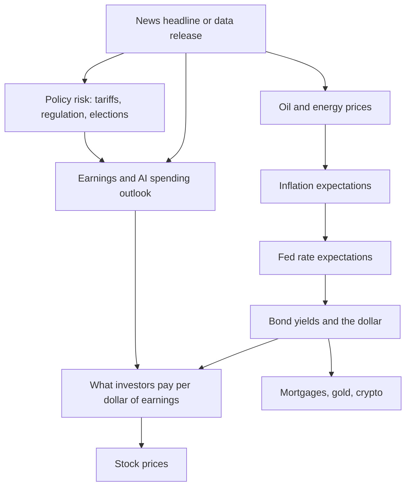

> [!SUMMARY] Bottom line (as of Monday, Nov 9, 2026)
> Stocks are up for 2026 but shaken. The S&P 500 is about **+8% year to date**, roughly **6% below its Oct 6 record**, after a post-midterm AI selloff on Nov 5 (S&P **−4.4%**, Nasdaq **−5.5%**). Earnings are booming (**+31% in Q3**), but three things now set the market's direction: oil (the US–Iran war), a Fed that is **raising rates, not cutting** (3.75–4.00%, with a December hike likely), and doubts over whether AI spending of about **$730B a year** will pay off. For a long-term investor the basics have not changed: diversify broadly, keep costs low, use tax-advantaged accounts, and don't sell in a panic. Cash and bonds now pay a real return, about **4%** on T-bills and **5.51%** on I bonds.

The short answer is that 2026 has been a year of shocks, and the long-term rules for investing still hold. Markets have absorbed a war that sent oil up about **70%**, a Fed that reversed from easing to tightening, a Supreme Court ruling that struck down the main legal basis for tariffs, a Democratic sweep of Congress, and record IPOs from rocket and AI companies. Through all of it, US large-cap stocks are up high single digits. Small caps, emerging markets, Japan, Korea and energy stocks have done better. The S&P 500's earnings have grown fast enough that its forward valuation has actually *fallen*, to about **17.7x**, below its 10-year average. The risk is that the market now leans heavily on one theme, AI infrastructure. About a third of the S&P 500 sits in seven mega-cap stocks, and investors have started punishing companies whose AI capital spending turns free cash flow negative. Bonds are less safe than they look: the 10-year Treasury yield hit **5.67%** in October, and the 2-year rose about **1 percentage point** this year as the Fed pivoted. The rest of this report explains how each news stream moved markets, covers the investing basics (accounts, 2026 limits, asset classes, taxes, behavior), and closes with practical takeaways for a young investor.

> [!CAVEAT] How far to trust these numbers
> This report was built from news and web-search **summaries**. Direct page fetches of most primary sources (IRS, IMF, FactSet, CNBC, the Fed) were blocked during research, so exact figures are "as reported" and were not checked against original documents. Many market numbers come from secondary blogs and aggregators. **Where sources conflicted, the conflict is flagged in the text.** Treat decimals as approximate, and check anything you act on against a primary source. This is educational content, not personalized financial advice.

## Where everything stands on Nov 9, 2026

The table below gives the latest readings found, mostly Friday Nov 6 closes. Context matters more than any single number. Stocks sit between a record high and a possible test of a widely watched technical level (the 200-day moving average). Bond yields are high but have eased from their October peak. Oil just had its biggest weekly fall since 2020. Gold and crypto are both well off their highs.

| Asset | Latest level | Recent move | 2026 context |
|---|---|---|---|
| S&P 500 | 7,376.86 (Nov 6) | −2.7% on the week | ~+7.8% YTD price, ~+8.7% total return; record 7,818.93 on Oct 6 |
| Nasdaq Composite | 24,579.42 | −3.4% wk, 4th straight weekly loss | Entered correction Nov 5; ~+5% YTD (weakly sourced) |
| Russell 2000 | n/a | ~−2% wk | ~+11% YTD, best US major index |
| 10-yr Treasury | ~4.86% | down ~7bp on week | Peaked 5.67% on Oct 7 |
| 2-yr Treasury | ~4.51% | — | +104bp YTD, as markets priced Fed hikes |
| Fed funds | 3.75–4.00% | Held Oct 28 (10–2) | Hiked Sept 16; Dec hike priced ~76–83% |
| Brent crude | ~$98.32 | −15 to −17% on week | ~$72 pre-war; futures high $126.41 (Apr 30) |
| Gold | ~$4,050–4,090/oz | +4.5–5% on week | Record ~$5,405 (Jan 29); ~−5.8% YTD |
| Bitcoin | ~$75–76k | −2% since Nov 1 | Spot ETF flows net negative for 2026 |
| Dollar index | ~101.5–102.3 | +0.75% on jobs day | Sources conflict on level |
| 30-yr mortgage | 7.18% | 3rd weekly decline | 2026 low 5.98% (late Feb) |

Sources: S&P levels ([chartrow](https://chartrow.com/sp500/ytd), an aggregator, and [CNBC](https://www.cnbc.com/2026/11/06/stock-market-next-week-outlook-for-nov-9-13-2026.html)); Nasdaq and Russell ([Investomine](https://investomine.substack.com/p/weekly-market-report6-november-2026); [T. Rowe Price](https://www.troweprice.com/personal-investing/resources/insights/global-markets-weekly-update.html)); yields ([ETF Trends](https://www.etftrends.com/fixed-income-content-hub/treasury-yields-snapshot-november-6-2026/); [Trading Economics](https://tradingeconomics.com/united-states/government-bond-yield)); Fed ([CNBC](https://www.cnbc.com/2026/10/28/fed-interest-rate-decision-october-2026.html)); oil ([Trading Economics](https://tradingeconomics.com/commodity/brent-crude-oil/news/530749); [IranWire/Reuters](https://iranwire.com/en/news/159893-global-oil-prices-drop-sharply-amid-reports-of-potential-iranus-peace-talks)); gold ([USAGOLD](https://www.usagold.com/daily-precious-metals-market-report-november-6-2026/); [Kitco](https://www.kitco.com/price/precious-metals)); bitcoin and dollar ([Ted Pillows Substack](https://tedpillows.substack.com/p/crypto-and-finance-market-report-65f); [Discovery Alert](https://discoveryalert.com/analysis/dollar-index-gold-liquidity-dxy-november-2026/)); mortgages ([Freddie Mac](https://www.globenewswire.com/news-release/2026/11/05/3396882/0/en/mortgage-rates-decline-for-third-consecutive-week-to-7-18.html)).

## Five shocks moved 2026 markets, and oil connected most of them

Almost every big market move this year traces back to one of five news streams. The diagram shows how a headline reaches your portfolio. A war headline moves oil. Oil moves inflation expectations. Inflation moves the Fed. The Fed moves bond yields, and yields change what investors will pay for future earnings. AI and policy headlines take a more direct path, through expected earnings.



| Date (2026) | Event | Market reaction |
|---|---|---|
| Jan 29 | Gold hits record ~$5,405 | Gold later falls ~25% by November |
| Feb 6 | Anthropic AI plug-ins trigger "SaaSpocalypse" | Software index −4% in a day; ~$285B lost in 24h |
| Feb 20 | Supreme Court strikes down IEEPA tariffs (6–3) | Replaced within days by a 10% global surcharge |
| Feb 28 | US–Israel strikes on Iran; Hormuz disrupted | Oil +~50% in March; S&P nears correction by Mar 30 |
| Apr 7–8 | Two-week ceasefire | S&P +~2.5%, Dow +~1,300; US crude −16.5% |
| May 22 | Kevin Warsh sworn in as Fed chair | Stocks tend to dip on Fed days under Warsh |
| Jun (mid) | US–Iran peace deal / MoU | Nikkei and KOSPI hit records |
| Sep 16 | Fed hikes to 3.75–4.00% | First hike since 2023 |
| Oct 6–7 | S&P record 7,818.93; 10-yr peaks at 5.67% | — |
| Oct 22–28 | Meta, Alphabet earnings: capex turns FCF negative | Meta −7%, Alphabet −12.6% in a day |
| Nov 4 | Democrats sweep Congress; Trump accepts result | Dow +1,569 (best post-midterm day in 44 yrs); oil −8% |
| Nov 5 | AI selloff on data-center regulation fears | S&P −4.4%, Nasdaq −5.5%, chip index −12.2% |

Sources: [SSGA](https://www.ssga.com/library-content/products/fund-docs/etfs/us/insights-investment-ideas/monthly-gold-monitor.pdf), [CNBC Feb 6](https://www.cnbc.com/2026/02/06/ai-anthropic-tools-saas-software-stocks-selloff.html), [Holland & Knight](https://www.hklaw.com/en/insights/publications/2026/02/supreme-court-strikes-down-ieepa-tariffs), [Britannica](https://www.britannica.com/event/2026-Iran-war), [Bloomberg Mar 30](https://www.bloomberg.com/news/articles/2026-03-30/us-stock-futures-rise-as-oversold-signals-lure-some-dip-buyers), [Al Jazeera](https://www.aljazeera.com/news/2026/4/8/oil-prices-slide-stocks-surge-as-trump-announces-two-week-iran-ceasefire), [PBS](https://www.pbs.org/newshour/politics/senate-confirms-trump-pick-warsh-as-chairman-of-the-federal-reserve-following-powell), [CNBC Oct 16](https://www.cnbc.com/2026/10/16/kevin-warsh-fed-october-rate-hike-interest-rates-markets.html), [Investing.com](https://www.investing.com/news/stock-market-news/asia-stocks-rise-with-nikkei-kospi-at-record-highs-as-us-iran-sign-peace-deal-4748945), [Chase](https://www.chase.com/personal/investments/learning-and-insights/article/federal-reserve-raises-rates-officials-signal-one-more-hike-in-2026), [CNBC Meta](https://www.cnbc.com/2026/10/22/meta-stock-q3-earnings-free-cash-flow.html), [CNN](https://www.cnn.com/2026/11/04/investing/us-markets-midterm-elections), [The National](https://www.thenationalnews.com/business/markets/2026/11/06/nasdaq-plunges-5-as-investors-dump-ai-stocks-after-midterms/).

### The Iran war is the year's master variable

The **US–Israel war on Iran began Feb 28, 2026** ([Britannica](https://www.britannica.com/event/2026-Iran-war)). Tehran effectively closed the Strait of Hormuz, which carries about a fifth of the world's oil and gas. The IEA called it the largest oil supply disruption on record, and oil rose about **50% in March**, its steepest monthly gain ever ([Nasdaq](https://www.nasdaq.com/articles/march-2026-review-and-outlook); [PPMHC](https://ppmhc.org/article/iran-conflict-wall-street-market-turmoil-oil-price-shock-explained), a lower-quality explainer). Brent went from about **$72** before the war to near **$120 by Mar 9**, then hit a futures high of **$126.41 on Apr 30**. One timeline cites a $131 spot peak, while CNBC described the peak as "nearly $120"; the gap reflects different price measures ([CNBC](https://www.cnbc.com/2026/04/21/oil-price-iran-war-middle-east.html); [Alupetra](https://www.alupetra.com/insights/iran-war-2026-timeline-oil-gas-markets.html)). The S&P 500 suffered its longest selloff since 2022. By Mar 30 it was less than 1% from a correction ([Bloomberg](https://www.bloomberg.com/news/articles/2026-03-30/us-stock-futures-rise-as-oversold-signals-lure-some-dip-buyers)).

After that, oil swung on each round of diplomacy. An Apr 7 ceasefire cut US crude about 16.5% in a day ([Al Jazeera](https://www.aljazeera.com/news/2026/4/8/oil-prices-slide-stocks-surge-as-trump-announces-two-week-iran-ceasefire)). Iran then reclosed the strait and Brent rebounded to $95 ([PBS](https://www.pbs.org/newshour/nation/oil-prices-rise-and-stocks-give-back-part-of-record-breaking-rally-following-latest-iran-tensions)). A June memorandum of understanding pushed prices down, strikes resumed Jul 7, and August trade sat in the mid-$80s ([CNBC Aug 10](https://www.cnbc.com/2026/08/10/oil-prices-today-brent-wti-hormuz-trump-iran.html)). Attacks on ships in mid-October sent Brent above **$107** ([Euronews](https://www.euronews.com/2026/10/14/oil-prices-rise-after-reported-attacks-on-ships-in-strait-of-hormuz)), and it settled at **$116.72 on Oct 23** ([Foreign Affairs Forum](https://www.faf.ae/home/2026/11/8/oil-on-the-brink-brents-wild-ride-through-trumps-second-term)). The Democratic midterm sweep, read by traders as raising the odds of a peace deal, together with Qatar-mediated talks, then produced the **steepest weekly drop since 2020**. Brent ended Nov 6 at **$98.32** ([IranWire/Reuters](https://iranwire.com/en/news/159893-global-oil-prices-drop-sharply-amid-reports-of-potential-iranus-peace-talks)).

```chart
{
  "type": "line",
  "title": "Brent crude in 2026: war, ceasefires and peace hopes",
  "caption": "Selected reported Brent prices, $/barrel. Points are unevenly spaced in time, and the August value is an approximation of 'mid-$80s'. Sources: Alupetra, CNBC, PBS, Euronews, Foreign Affairs Forum, Reuters via IranWire.",
  "data": {
    "labels": ["Late Feb (pre-war)", "Mar 9", "Apr (strait reclosed)", "Apr 30 (futures high)", "Aug (approx.)", "Oct 14", "Oct 23", "Nov 6"],
    "datasets": [
      { "label": "Brent ($/bbl)", "data": [72, 120, 95.28, 126.41, 85, 107, 116.72, 98.32], "tension": 0.2 }
    ]
  },
  "options": { "scales": { "y": { "min": 60 } } }
}
```

The war is not over. Tanker attacks continue, Hormuz flows have reportedly run below 60% of capacity on some measures, no formal deal has been announced, and Trump has said he is choosing between a deal and further military action ([OilPrice.com](https://oilprice.com/Energy/Energy-General/The-Iran-War-Isnt-Over-but-Oil-Traders-Are-Already-Pricing-In-Peace.html)). Other reports say Hormuz crude volumes are near pre-war levels, but at higher cost ([NBC News](https://www.nbcnews.com/business/energy/oil-prices-iran-war-midterms-rcna607448)). Oil is still roughly **60–70% above pre-war levels**. Goldman's December Brent forecast is **$105**, with **$140** possible if Gulf output stays depressed ([OilPrice.com](https://oilprice.com/Energy/Energy-General/The-Iran-War-Isnt-Over-but-Oil-Traders-Are-Already-Pricing-In-Peace.html)). OPEC+ has left quotas unchanged for November and December, but with Gulf exports at 60–80% of normal, its announced increases exist mostly on paper ([Bloomberg](https://www.bloomberg.com/news/articles/2026-11-01/opec-set-to-stick-with-plan-for-steady-quotas-delegates-say); [Enerdata](https://www.enerdata.net/publications/daily-energy-news/opec-keeps-november-2026-production-targets-unchanged-amid-supply-disruptions.html)). The market is pricing peace faster than the shipping lanes show it. That makes oil the most likely source of a renewed shock to inflation and bonds.

## The Fed turned from cutting to hiking, and bonds felt it

The most important macro change of 2026 is that **the Fed is debating rate hikes, not cuts**. After three cuts in 2025, it held at **3.50–3.75%** in January and March ([ABC News](https://abcnews.com/Business/fed-set-adjust-interest-rates-1st-time-war/story?id=131155455); [Washington Post](https://www.washingtonpost.com/business/2026/03/18/fed-interest-rates-iran-inflation/)). Kevin Warsh was confirmed 54–45 and sworn in as chair on May 22 ([PBS](https://www.pbs.org/newshour/politics/senate-confirms-trump-pick-warsh-as-chairman-of-the-federal-reserve-following-powell)). The Fed held again at his first meeting on Jun 17 ([Al Jazeera](https://www.aljazeera.com/economy/2026/6/17/us-federal-reserve-holds-rates-steady-under-new-chair-warsh)). On **Sept 16 it raised rates 25bp to 3.75–4.00%**, its first hike since 2023, and the median projection pointed to one more hike in 2026 ([Chase](https://www.chase.com/personal/investments/learning-and-insights/article/federal-reserve-raises-rates-officials-signal-one-more-hike-in-2026)). On Oct 28 it held by a **10–2 vote**. Lisa Cook and Beth Hammack dissented in favor of an immediate hike ([CNBC](https://www.cnbc.com/2026/10/28/fed-rate-decision-warsh-takeaways.html)). Cook is the governor Trump tried to fire, and the Supreme Court let her stay in June ([NPR via OPB](https://www.opb.org/article/2026/06/29/supreme-court-says-fed-s-lisa-cook-can-stay-in-her-job-for-now/)). Her hawkish vote undercuts the simple story that a Trump-picked chair means easy money. Futures put the odds of a **Dec 8–9 hike at about 76–83%** ([BYDFi](https://www.bydfi.com/market-intelligence/article/fomc-october-2026-results-1/1356), a lower-quality source; [Ted Pillows Substack](https://tedpillows.substack.com/p/crypto-and-finance-market-report-65f)).

> [!WARNING] Conflicting reports on the rate level
> Most coverage, including CNBC, Chase and Fox Business, puts the target range at **3.75–4.00%** after the September hike. One snapshot of Wikipedia still listed 3.50–3.75%. This report uses 3.75–4.00%. The outcomes of the April and July meetings were not confirmed, but they were almost certainly holds.

```chart
{
  "type": "line",
  "title": "Fed funds target range in 2026",
  "caption": "Upper and lower bounds at each confirmed decision, in %. The December point is the market-implied outcome (about 76-83% odds), not a decision. April and July meetings are omitted as unconfirmed holds. Sources: ABC, Washington Post, Al Jazeera, Chase, CNBC, BYDFi.",
  "data": {
    "labels": ["Jan", "Mar 18", "Jun 17", "Sep 16", "Oct 28", "Dec 9 (priced)"],
    "datasets": [
      { "label": "Upper bound (%)", "data": [3.75, 3.75, 3.75, 4.00, 4.00, 4.25], "stepped": true },
      { "label": "Lower bound (%)", "data": [3.50, 3.50, 3.50, 3.75, 3.75, 4.00], "stepped": true }
    ]
  },
  "options": { "scales": { "y": { "min": 3.0, "max": 4.5 } } }
}
```

The data support a hawkish Fed. **September PCE inflation was 3.6%**, and core PCE was **3.1%**, well above the 2% target. Energy drove the rise, and economists worry it is spreading into other prices ([CNBC](https://www.cnbc.com/2026/10/29/pce-inflation-report-september-2026-.html)). September CPI was **3.7%** year over year ([TD Economics](https://economics.td.com/us-cpi)). The reported 2.6% core CPI looks inconsistent with 3.1% core PCE, because core PCE usually runs *below* core CPI, so treat it as possibly mis-summarized. **Q3 GDP grew at a 3.4% annualized rate** ([BEA](https://www.bea.gov/news/2026/gdp-advance-estimate-3rd-quarter-2026)). **October payrolls rose 165,000**, against a consensus of about 60,000, and unemployment fell to **4.1%** ([CNBC](https://www.cnbc.com/2026/11/06/jobs-report-october-2026.html)). The dollar and yields rose on that report, and December hike odds firmed. One quirk: the **October CPI report due Nov 10 will have no headline year-over-year rate**, because October 2025 prices were never collected during the 2025 shutdown ([BLS](https://www.bls.gov/cpi/additional-resources/2025-federal-government-shutdown-impact-cpi-faq.htm)). The Fed will be setting policy with a gap in its inflation data.

For bond investors, the result has been a **bear flattening**: short-term yields rose more than long-term ones. The **2-year is up about 104bp YTD to 4.51%**, while the 30-year is up only about 40bp to 5.26% ([ETF Trends](https://www.etftrends.com/fixed-income-content-hub/treasury-yields-snapshot-november-6-2026/)). The 10-year spiked to **5.67% on Oct 7**, then fell about 80bp as oil eased ([Trading Economics](https://tradingeconomics.com/united-states/government-bond-yield)). The curve still slopes upward, with 10-year minus 2-year at about +32bp. Mortgage rates followed: Freddie Mac's 30-year fixed is **7.18%**, up from 6.22% a year ago and from a 2026 low of 5.98% in February ([Freddie Mac](https://www.globenewswire.com/news-release/2026/11/05/3396882/0/en/mortgage-rates-decline-for-third-consecutive-week-to-7-18.html)).

```chart
{
  "type": "bar",
  "title": "US Treasury yield curve, early Nov 2026",
  "caption": "Approximate yields in %. 3-month is the October 2026 monthly average on a discount basis (FRED TB3MS); others are Nov 6 closes. The 10-year peak (5.67%, Oct 7) is shown for reference. Sources: FRED, ETF Trends, Trading Economics.",
  "data": {
    "labels": ["3-month T-bill", "2-year", "10-year", "30-year", "10-year Oct 7 peak"],
    "datasets": [ { "label": "Yield (%)", "data": [4.05, 4.51, 4.86, 5.26, 5.67] } ]
  },
  "options": { "scales": { "y": { "min": 3.5 } } }
}
```

Other central banks tightened too. The **ECB** raised its deposit rate to **2.50%** with hikes in June and September. The **Bank of Japan** raised rates to **1.25%**, its highest in decades, and held in a "hawkish hold" on Oct 30 ([Trading Economics](https://tradingeconomics.com/japan/interest-rate); [Fattail](https://fattail.ai/boj-hawkish-hold-october-2026/)). The **Bank of England** appears to have raised Bank Rate to **4.0% on Nov 5**, citing energy prices ([House of Commons Library](https://commonslibrary.parliament.uk/research-briefings/sn02802/)); this was not checked against the BoE's own release. China is the exception, using only targeted easing, such as a cut to a relending rate for stock buybacks ([IndexBox](https://www.indexbox.io/blog/pboc-strengthens-stock-repurchase-re-lending-policy-cuts-rate-to-1/)). Taken together, this is a global tightening in response to an energy shock, the opposite of the "rate cuts are coming" story many investors entered 2026 with.

## Stocks: record earnings, cheaper multiples, fragile leadership

The equity story of 2026 has a paradox at its center. **Earnings are booming while the market's valuation has fallen.** FactSet's Nov 6 update shows **Q3 S&P 500 earnings growth of 31.4%** on revenue growth of 14.3%, with **84% of companies beating estimates**, compared with a 5-year average of 78% ([FactSet Earnings Insight](https://www.factset.com/earningsinsight)). Growth was broad. The "other 493" companies grew about **32.6%**, faster than the Magnificent 7's roughly 22.6% ([Butterfly Market Insider](https://butterflymarketinsider.substack.com/p/the-smallest-earnings-beat-since), a secondary source). The energy windfall from high oil likely explains much of that gap. Because earnings rose faster than prices, the **forward P/E is 17.7**, below the 5-year average of 19.8 and the 10-year average of 19.1, and the lowest since Nov 2023 ([FactSet](https://www.factset.com/earningsinsight)). Analysts expect **2027 EPS growth of 16.1%** ([FactSet](https://www.factset.com/earningsinsight)). Goldman expects 18% ([Yahoo/Motley Fool](https://finance.yahoo.com/markets/stocks/articles/goldman-sachs-research-expects-slower-105000319.html)).

> [!FINDING] Why "cheap" is not quite cheap
> A 17.7x forward P/E is only low because forward earnings estimates have risen so quickly. If 2027 profit growth falls well short of the ~16% consensus, especially in AI-linked companies, that valuation cushion disappears. One undated blog cites a 21.8x P/E that conflicts with FactSet; this report prefers FactSet. No current Shiller CAPE reading was found.

Leadership this year has been unusual. **Energy is the best S&P 500 sector, up about 53% YTD** on the oil shock. **Communication Services is the worst, down about 14%**, as investors penalize heavy AI spending ([Opening Bell Daily](https://www.openingbelldailynews.com/p/sp-500-sector-performance-2026-energy-tech-beating-index-chart), an aggregator; [YCharts](https://get.ycharts.com/resources/blog/monthly-market-wrap/)). Small caps, at about +11%, beat large caps. Outside the US, **emerging markets were up about 24% YTD by early October**, against about 7% for developed international markets (EAFE) ([D.A. Davidson](https://www.dadavidson.com/Portals/0/Wealth_Management/Research/MorningMarketDashboard.pdf?ver=1723654459458)). Japan's Nikkei hit records after PM Sanae Takaichi's February election win and again on the June peace deal, peaking around 71,477, but fell below 60,000 on Nov 6 ([CNBC Feb 9](https://www.cnbc.com/2026/02/09/japan-stocks-set-to-soar-after-takaichi-secures-historic-mandate.html); [Saxo](https://www.home.saxo/en-sg/content/articles/macro/asia-market-quick-take-06-november-2026-06112026)). Korea's KOSPI hit records on chip demand ([Investing.com](https://www.investing.com/news/stock-market-news/asia-stocks-rise-with-nikkei-kospi-at-record-highs-as-us-iran-sign-peace-deal-4748945)).

```chart
{
  "type": "bar",
  "title": "2026 year-to-date returns: indices (mixed dates)",
  "caption": "% change YTD. S&P 500, Russell 2000 and Nasdaq as of ~Nov 6; MSCI EM and EAFE (USD) as of Oct 6 and likely lower after the November selloff. Nasdaq figure is weakly sourced. Sources: chartrow/historyofmarket (aggregators), T. Rowe Price, Epoch Times, D.A. Davidson.",
  "data": {
    "labels": ["MSCI Emerging Mkts (Oct 6)", "Russell 2000", "S&P 500 (total return)", "S&P 500 (price)", "MSCI EAFE (Oct 6)", "Nasdaq Composite (approx.)"],
    "datasets": [ { "label": "YTD %", "data": [23.89, 11.0, 8.67, 7.83, 7.19, 5.0] } ]
  },
  "options": { "indexAxis": "y" }
}
```

```chart
{
  "type": "bar",
  "title": "S&P 500 sectors: the 2026 extremes",
  "caption": "Approximate YTD % (mixed dates, Oct 14 to early Nov). Sources conflict: Tech is ~+32% in one source vs ~+21% in another; Consumer Discretionary is -6.6% vs about -0.4%. Sources: Opening Bell Daily, Finbold, chartrow (aggregators).",
  "data": {
    "labels": ["Energy (XLE)", "Technology (XLK)", "Consumer Discretionary", "Communication Services"],
    "datasets": [ { "label": "YTD % (approx.)", "data": [53.4, 32, -6.6, -14.1] } ]
  },
  "options": { "indexAxis": "y" }
}
```

Concentration makes the index fragile. The **Magnificent 7 make up about 33–35% of the S&P 500**, a level widely compared with the dot-com era ([Motley Fool](https://www.fool.com/research/magnificent-seven-sp-500/); [Forbes](https://www.forbes.com/sites/investor-hub/article/sp-500-weight-mag-7-stocks-diversification-risk/)). On Nov 5 alone they lost about **$1 trillion** in market value, and Nvidia fell more than 9% ([CNBC](https://www.cnbc.com/2026/11/05/stock-market-selloff-ai-fears.html)). A "diversified" S&P 500 index fund is therefore also a large bet on AI infrastructure. Wall Street remains constructive. Goldman and Morgan Stanley target **8,000 for end-2026**, about 8% above the Nov 6 close, and Goldman targets **8,700 for end-2027** ([Bloomberg](https://www.bloomberg.com/news/articles/2026-05-27/goldman-strategists-lift-s-p-500-target-to-8-000-on-ai-earnings); [Yahoo/Goldman](https://finance.yahoo.com/news/goldman-sachs-doubles-down-bold-153300685.html); [Beinsure](https://beinsure.com/news/sp500-forecast-goldman-sachs-jpmorgan-morgan-stanley-target/)). Strategists in the near term are watching the **200-day moving average near 7,306** ([CNBC](https://www.cnbc.com/2026/11/06/stock-market-next-week-outlook-for-nov-9-13-2026.html)).

```chart
{
  "type": "bar",
  "title": "S&P 500: key 2026 levels and targets",
  "caption": "Index points. The Mar 30 low comes from an aggregator and was not confirmed by a primary source. Targets are forecasts, not predictions to rely on. Sources: chartrow, CNBC, Real Investment Advice, Bloomberg, Yahoo/Goldman.",
  "data": {
    "labels": ["2026 closing low, Mar 30", "Mar 25 close (war selloff)", "200-day avg (BTIG est.)", "Nov 6 close", "Nov 4 close (post-midterm)", "Oct 6 record close", "GS/MS end-2026 target", "GS end-2027 target"],
    "datasets": [ { "label": "S&P 500", "data": [6343.72, 6477.16, 7306, 7376.86, 7688.62, 7818.93, 8000, 8700] } ]
  },
  "options": { "indexAxis": "y", "scales": { "x": { "min": 6000 } } }
}
```

The IPO market and retail flows show where risk appetite stands. 2026 is a **record year for US IPO proceeds**, about $148B against 2021's $142B, driven by **SpaceX's roughly $75B IPO in June**, the largest ever. The number of deals is down about 34%, so a few mega-issuers account for most of the total ([NPR](https://www.npr.org/2026/06/11/nx-s1-5853199/spacex-ipo-price-elon-musk); [BBAE](https://www.bbae.com/blog/spacex-openai-anthropic-a-record-ipo-year/)). Retail investors bought dips at a record pace in January ([Axios](https://www.axios.com/2026/01/23/stock-market-wall-street-retail)). On Nov 5 they **net sold $257M of single stocks**, one of the largest one-day retail outflows since March 2020. The only visible dip-buying was in leveraged ETFs such as TQQQ and SOXL ([Yahoo Finance](https://finance.yahoo.com/markets/stocks/articles/retail-investors-dumped-stocks-wall-182917680.html)).

## AI is the trade holding up the index, and investors are now testing its numbers

AI drives both the bull case and the main risk for 2026 markets. The four largest hyperscalers (Alphabet, Amazon, Microsoft, Meta) now guide to about **$720–745B of 2026 capital spending** ([Alpha Agentic tracker](https://www.thealphaagentic.com/hyperscaler-capex-tracker/)). Alphabet raised its range to **$195–205B** and said 2027 will "increase significantly". Amazon reaffirmed about **$220B**. Meta narrowed its range to **$135–145B**. Microsoft guided next-quarter spending above $50B, and its calendar-2026 total is reported as $170–175B, with sources mixing fiscal and calendar years ([CNBC AWS](https://www.cnbc.com/2026/10/29/aws-q3-earnings-report-2026.html); [CNBC Meta](https://www.cnbc.com/2026/10/22/meta-stock-q3-earnings-free-cash-flow.html)). Sell-side analysts expect about **$1.14T combined in 2027** (Goldman) ([Yield Theory](https://www.yieldtheory.app/research/hyperscaler-capex-2027-forecast)).

```chart
{
  "type": "bar",
  "title": "Hyperscaler capex: 2026 guidance vs 2027 sell-side estimates",
  "caption": "$ billions. 2026 = midpoint of company guidance (Microsoft's calendar-year figure is inconsistent across sources, ~$170-175B). 2027 = analyst estimates, not company guidance. Sources: Alpha Agentic, CNBC, Yield Theory (secondary trackers).",
  "data": {
    "labels": ["Alphabet", "Amazon", "Microsoft", "Meta"],
    "datasets": [
      { "label": "2026 guidance (midpoint)", "data": [200, 220, 172.5, 140] },
      { "label": "2027 sell-side estimate", "data": [284.8, 256.5, 207.6, 185.6] }
    ]
  }
}
```

The market's question has shifted from "are you spending?" to **"can your cash flow fund it?"** Microsoft's Azure grew **48%** and its free cash flow stayed positive, and the stock was flat after earnings. Alphabet's Google Cloud reportedly grew **103%**, a figure that should be checked against its filing, but Q3 capex of about $51B pushed **free cash flow to about −$9B**, and the stock fell **12.6%** ([vlsi.kr](https://www.vlsi.kr/en/alphabet-microsoft-q3-2026-earnings-13-facts-en/), secondary). Meta's free cash flow also turned negative, and the stock fell **7%** ([CNBC](https://www.cnbc.com/2026/10/22/meta-stock-q3-earnings-free-cash-flow.html)). Its credit default swap spreads hit all-time highs, and there are reports, from weak sources, of a large equity raise through a new non-voting share class ([24/7 Wall St.](https://247wallst.com/investing/2026/10/31/sp-says-meta-cant-make-money-from-ai-as-well-as-its-rivals/)). Amazon's AWS grew **39%**, its fastest growth since 2021 ([CNBC](https://www.cnbc.com/2026/10/29/aws-q3-earnings-report-2026.html)).

The suppliers are still booming. **Nvidia's latest reported quarter brought $96.2B of revenue (+106% YoY) at a 75% gross margin** ([Nvidia 8-K](https://www.sec.gov/Archives/edgar/data/0001045810/000104581026000073/q2fy27pr.htm)). Its next report, reportedly **Nov 17**, is the next big test for the AI trade. AMD's data-center revenue nearly doubled to $8.5B, though it booked a **$1.1B charge for warrants issued to OpenAI and Meta** ([AMD](https://www.globenewswire.com/news-release/2026/11/03/3394824/0/en/amd-reports-third-quarter-2026-financial-results.html)). In that arrangement a supplier gives equity to its customers in return for purchase commitments, a textbook case of the "circular financing" critics point to. TSMC's Q3 revenue rose about 51% ([Yahoo Finance](https://finance.yahoo.com/technology/ai/articles/beyond-nvidia-why-tsmc-stock-180000531.html)).

The private AI labs are heading for public markets. **Anthropic filed a public S-1 on Oct 26 (ticker ANT, Nasdaq)**. It disclosed H1 2026 revenue of **$16.3B, about 14x a year earlier**, and an $80.7B net loss driven mostly by non-cash fair-value charges on convertible bonds ([Fortune](https://fortune.com/2026/10/26/anthropics-s-1/)). An amended filing reportedly shows Q3 revenue of about $17B and **$895B of compute commitments** ([thevccorner](https://www.thevccorner.com/p/anthropic-s1-ipo-filing), secondary). Reports put its target valuation at **$1.25–2T**, with a listing possibly before Thanksgiving ([cryptobriefing citing Reuters](https://cryptobriefing.com/openai-accelerates-fundraising-as-anthropic-eyes-15t-ipo-reuters/)). **OpenAI** is raising up to $30B at a **$1.25T pre-money valuation** ahead of a planned **2027 IPO** ([CNBC](https://www.cnbc.com/2026/10/22/openai-funding-round-uae-investors.html); [TechCrunch](https://techcrunch.com/2026/10/22/openai-working-on-new-30b-raise-at-1-25t-valuation-ahead-of-ipo/)). **xAI was folded into SpaceX** in February, before SpaceX's June IPO ([Wikipedia: SpaceXAI](https://en.wikipedia.org/wiki/SpaceXAI)). Anthropic's revenue is reported gross of cloud-partner resale, and OpenAI's is net, so headline comparisons between them overstate the gap.

The credit side shows the most stress. **Oracle was cut to BBB−**, one notch above junk, in July. About **45% of its $664B backlog is a single OpenAI contract**. It carries about $167B of debt including leases, plus $288B of off-balance-sheet commitments ([Axios](https://www.axios.com/2026/09/25/oracle-debt-data-centers); [IntuitionLabs](https://intuitionlabs.ai/articles/oracle-openai-300b-deal-analysis); [useluminix](https://www.useluminix.com/reports/company-overviews/oracle-ai-debt-openai-contract), secondary). Financing for its $16.3B Michigan campus needed PIMCO as an anchor after banks pulled back ([The Next Web](https://thenextweb.com/news/oracle-data-centre-16-billion-financing-stargate)). Power is the physical bottleneck. PJM's capacity price jumped to **$329/MW-day**, from $29 two years earlier ([oilandgas360](https://www.oilandgas360.com/ai-demand-drives-largest-u-s-electricity-auction-price-to-record-high/)), and the resulting higher electricity bills fed the voter backlash behind the midterm selloff.

| Bubble case | Counter-case |
|---|---|
| ~$730B of capex in 2026, ~$1.1T+ expected in 2027 | Cloud revenue is accelerating: Azure +48%, AWS +39%, Google Cloud reportedly +103% |
| Alphabet and Meta free cash flow negative; Meta and Oracle CDS spreads at records | Suppliers earn ~75% gross margins and report persistent capacity shortages |
| Vendor-financing loops (AMD warrants, Stargate equity, Oracle–OpenAI) | Anthropic revenue ~14x YoY; OpenAI ~$50B net run-rate |
| Labs valued at roughly 18–30x run-rate revenue | AI-native revenue near ~$150B annualized narrows the oft-cited "$600B gap" |

Sources: [useluminix](https://www.useluminix.com/reports/industry-analysis/how-much-revenue-is-required-to-justify-the-ai-capex-buildout-and-avoid-a-bubble) (revenue-gap framing), [IoT Analytics](https://iot-analytics.com/why-there-is-no-ai-bubble-analysis/), [Allianz Trade](https://www.allianz-trade.com/en_global/news-insights/economic-insights/AI-capex-cycle-war-proof-now.html). The ~$150B and 18–30x figures are this report's own estimates built from the cited revenue numbers.

On balance, the evidence points to a **boom in genuine demand that is now financed in a late-cycle way**. Revenue is real and growing fast, but the build-out has moved from self-funding to debt, leases and equity raises. The weakest point is not Nvidia but the **leveraged middle layer**: Oracle, data-center developers and their lenders. A roughly $500M pool of data-center loans going up for auction, with bids due Nov 19, is an early warning sign worth watching ([Startup Fortune](https://startupfortune.com/a-500-million-pile-of-data-center-loans-just-hit-the-auction-block/)).

AI is also showing up in the labor market and in policy. Stanford researchers using ADP data find that employment of 22–25-year-olds in the most AI-exposed jobs is about **19% below** that of less-exposed peers, driven by fewer hires rather than layoffs ([Stanford SIEPR](https://siepr.stanford.edu/publications/policy-brief/what-really-happening-jobs-separating-ai-hype-reality)). Economy-wide effects remain small ([Washington Post](https://www.washingtonpost.com/education/2026/09/28/is-ai-killing-jobs-college-grads-not-yet-new-study-says/)). In policy, the White House is pushing federal preemption of state AI laws through a DOJ litigation task force, and Congress has repeatedly declined to legislate it ([Ropes & Gray](https://www.ropesgray.com/en/insights/alerts/2026/03/examining-the-landscape-and-limitations-of-the-federal-push-to-override-state-ai-regulation)). The EU delayed its AI Act high-risk deadlines to Dec 2027 ([CSA](https://labs.cloudsecurityalliance.org/research/csa-research-note-eu-ai-act-omnibus-vii-deadline-delay-20260/)). The US licenses some older Nvidia chips to China case by case, but Nvidia has reported no China revenue from them because Beijing restricted the purchases ([BIS](https://www.bis.gov/press-release/department-commerce-revises-license-review-policy-semiconductors-exported-china); [Nvidia 10-Q](https://www.sec.gov/Archives/edgar/data/0001045810/000104581026000075/nvda-20260726.htm)).

## Washington: divided government, rebuilt tariffs and a crowded fiscal calendar

**Democrats swept the Nov 3 midterms** and will control both chambers from January 2027 ([NBC News](https://www.nbcnews.com/politics/2026-election/live-blog/election-results-house-senate-trump-live-updates-rcna607376); [CNBC](https://www.cnbc.com/2026/11/04/democrats-2026-midterm-election-results.html)). The Senate stands at about **54 D – 44 R**, with Alaska and Mississippi uncalled. House tallies vary by source; one AP-based count has 254–162 with races still open ([Yahoo News](https://www.yahoo.com/news/politics/live/midterms-2026-election-results-and-latest-updates-mississippi-votes-still-being-counted-in-senate-nail-biter-after-democrats-take-control-of-congress-200037541.html)). Markets first cheered. On Nov 4 the **Dow gained 1,569 points, its best post-midterm day in 44 years**, and the S&P rose 1.6–2% as Trump accepted the result and oil fell ([CNN](https://www.cnn.com/2026/11/04/investing/us-markets-midterm-elections); [Fidelity](https://www.fidelity.com/learning-center/trading-investing/2026-midterm-elections-and-stocks)). "Markets like gridlock and that's what we got," said Fidelity's Jurrien Timmer. A day later the mood reversed. Voters rejected data-center proposals in **39 of 40 ballot measures**, and investors began pricing in Democratic oversight of the AI build-out ([NPR](https://www.npr.org/2026/11/05/nx-s1-6031987/stock-markets-ai-midterm-elections)). The broad market likes gridlock, but the AI trade fears regulation. No legislation has passed yet; for now this is a repricing of expected regulation.

The Fed's political setting also changed. The **Supreme Court, in June, left Lisa Cook in office**, rejecting the argument that a "for cause" removal cannot be reviewed by courts, even as it overturned protections for other independent agencies ([NPR via OPB](https://www.opb.org/article/2026/06/29/supreme-court-says-fed-s-lisa-cook-can-stay-in-her-job-for-now/)). From January, a Democratic Senate will control confirmations of Fed governors.

Tariffs were legally rebuilt during the year rather than removed. On **Feb 20, the Supreme Court ruled 6–3 in *Learning Resources v. Trump* that IEEPA does not authorize tariffs** ([Holland & Knight](https://www.hklaw.com/en/insights/publications/2026/02/supreme-court-strikes-down-ieepa-tariffs)). The administration replaced them with a 10% Section 122 global surcharge (Feb 24–Jul 24), then with **Section 301 tariffs of mostly 10–12.5%** on dozens of economies. Section 232 sector tariffs stayed in place, including a 100% tariff on patented pharmaceuticals ([Troutman](https://www.troutman.com/insights/supreme-court-strikes-down-ieepa-tariffs-trump-responds-with-section-122-global-surcharge/); [Wiley](https://www.wiley.law/trump-administration-tariff-tracker)). Yale estimates the average statutory tariff rate at about **11.1%**, near its highest since the 1940s ([Yale Budget Lab](https://budgetlab.yale.edu/sites/default/files/page_to_pdf/1568/publication_1568.pdf)). As a side effect, **about $126B of IEEPA refunds, including interest, has been certified** to importers ([C.H. Robinson](https://www.chrobinson.com/en-us/resources/insights-and-advisories/client-advisories/2026q3/09-17-26-cbp-cape-phase-3-ieepa-refunds/)). That is a cash windfall for retailers and industrials, and it adds to Treasury's borrowing needs.

The fiscal calendar is crowded. Government funding runs out on **Dec 11, 2026**, and another stopgap bill in the lame-duck session is likely ([Holland & Knight](https://www.hklaw.com/en/insights/publications/2026/10/beyond-the-midterms-congress-faces-converging-year-end-deadlines)). The debt limit is projected to bind around **May 2027**, with the Treasury's "X-date" around February 2028 ([NTU](https://www.ntu.org/publications/detail/projecting-the-debt-limit)). Under divided government that becomes a 2027–28 risk for T-bills. The 2025 tax law (OBBBA) made the TCJA individual tax cuts permanent, so there is **no 2026 tax cliff**. CBO scored it at about **$3.4T** of added deficits through 2034 ([CRFB](https://www.crfb.org/blogs/whats-one-big-beautiful-bill-act)), one reason long-term yields stay high. The government also now holds equity stakes in companies such as **Intel (~10%) and MP Materials (15%)** ([Yahoo/Benzinga](https://finance.yahoo.com/news/trump-administration-now-holds-stakes-023008085.html)), a new kind of industrial policy. Trump's approval is about **38%**, with net approval on the economy at **−31** ([Silver Bulletin](https://www.natesilver.net/p/trump-approval-ratings-nate-silver-bulletin)). Affordability is the dominant voter issue.

## Beyond the US: slower growth, an energy shock and rolling truces

The IMF's October outlook projects **global growth of 3.1% in 2026 and 3.4% in 2027**, with **global inflation of 4.7%**. Its forecast assumes the Iran war does not escalate ([IMF WEO](https://www.imf.org/en/publications/weo/issues/2026/10/13/world-economic-outlook-october-2026); [Fortune](https://fortune.com/2026/10/13/imf-global-growth-forecast-2026-ai-economic-divide/)). The US is the fastest-growing G7 economy at 2.3%. China is forecast at 4.5%, India at about 7%, the euro area at 1.1% and Japan at 0.7% ([IMF briefing](https://www.imf.org/en/news/articles/2026/10/13/tr-101326-press-briefing-transcript-world-economic-outlook-annual-meetings-2026); [EACC](https://eaccny.com/news/chapternews/imf-world-economic-outlook-october-2026-global-growth-holds-up-at-3-1-eurozone-at-1-1/)). Growth is becoming more concentrated: **32 economies now produce 95% of global growth**, down from 54 in April ([CNBC](https://www.cnbc.com/2026/10/12/imf-world-bank-annual-meetings-october-bangkok-asia-.html)).

| Region | What is happening | Why investors care |
|---|---|---|
| US–China | Trade truce extended only to **Jan 10, 2027**; rare-earth controls suspended | Next cliff date for tariffs, magnets, soybeans and chips |
| China | Q3 GDP +4.5%, exports +28%; property investment −20.6% | Export-led growth on AI hardware; weak domestic demand |
| Japan | BoJ at 1.25%; 30-yr JGB record 4.235%; USD/JPY ~158 | Rising Japanese yields push up global bond yields and threaten the carry trade |
| France | 10-yr spread ~153bp over Germany; minority government; 2027 election | Euro-area sovereign debt risk |
| Russia–Ukraine | US-mediated talks in Abu Dhabi ~Nov 10–11; no general ceasefire | Peace headlines hit defense stocks (Rheinmetall ~−35% YTD per one analysis) |
| Brazil | Lula won Oct 25 runoff; opponent seeking annulment | Brazilian assets sold off (size unverified) |

Sources: [CNBC Sep 24](https://www.cnbc.com/2026/09/24/us-china-trade-truce-bessent-trump-xi.html), [Japan Times](https://www.japantimes.co.jp/business/2026/11/07/economy/us-china-rare-earths-agriculture/), [Al Jazeera](https://www.aljazeera.com/economy/2026/10/19/chinas-economy-grows-4-5-percent-in-q3-beating-forecasts), [CES Intelligence](https://www.ces-intelligence.com/analysis/china-q3-gdp-property-slide-2026-daily-signal), [Admiral Markets](https://admiralmarkets.com/analytics/traders-blog/jgb-yields-record-japan-bond-market), [CNBC Oct 19](https://www.cnbc.com/2026/10/19/takaichi-weak-yen-jgb-yields.html), [Euronews](https://www.euronews.com/2026/10/06/frances-sovereign-debt-crisis-explained-how-dangerous-could-it-be), [NPR](https://www.npr.org/2026/11/08/nx-s1-6034014/europe-join-us-brokered-ukraine-talks-abu-dhabi-russia), [RFE/RL](https://www.rferl.org/a/us-russia-ukraine-peace-talks-abu-dhabi-ceasefire/33889451.html), [MarketScreener](https://www.marketscreener.com/quote/stock/RHEINMETALL-AG-436527/news/European-defense-analysts-aren-t-backing-down-targeting-three-stocks-54313169/), [CNBC Brazil](https://www.cnbc.com/2026/10/26/brazil-lula-win-presidential-election-runoff-vote.html).

Two longer-running themes matter for portfolios. **European defense spending** is a structural tailwind: NATO projects $634B in 2026 from European allies and Canada, and Germany has exempted defense from its debt brake. Even so, defense stocks fall on every peace headline, which shows how much optimism was already in their prices ([Goldman Sachs](https://www.goldmansachs.com/insights/articles/defense-spending-to-boost-german-and-european-gdp-growth)). **Japan's exit from ultra-low rates**, with the 10-year JGB near 2.9% (its highest since 1996), matters for everyone because Japanese investors are major buyers of foreign bonds ([Nikkei Asia](https://asia.nikkei.com/business/markets/bonds/japan-bond-yields-spike-on-takaichi-budget-fears-worries-over-us-view)). Elsewhere, the US capture of Maduro in January added some Venezuelan oil, but too little to change prices much ([NPR](https://www.npr.org/2026/06/07/nx-s1-5846935/venezuela-is-exporting-more-oil-after-the-u-s-captured-maduro)).

## Beyond stocks: bonds, cash, gold and crypto in 2026

**Cash pays a real return again.** The 3-month T-bill averaged about **4.05%** in October ([FRED](https://fred.stlouisfed.org/series/tb3ms)). **I bonds bought from Nov 1, 2026 through Apr 30, 2027 earn 5.51%**, made up of a 1.40% fixed rate (the highest since 2006) plus an inflation component ([Doctor of Credit](https://www.doctorofcredit.com/new-i-bonds-rate-5-51-apy-variable-4-11-fixed-1-40/); [Crowdfunded Wealth](https://www.crowdfundedwealth.com/articles/i-bond-rate-november-2026-fixed-rate-1-40-percent-5-51-composite)). These figures come from secondary reports of the Treasury announcement. The 1.40% fixed rate means an I bond bought now beats inflation by that margin for its whole 30-year life. High-yield savings and money market funds usually track T-bills within about half a point, but no current rates were verified.

**Bonds** carry interest-rate risk. A bond fund's *duration* tells you roughly how much it loses for each 1-point rise in yields: a fund with a 6-year duration loses about 6%. That is why long bonds fell hard in 2022 and why this year's 2-year yield jump hurt short-term bond prices. With the 10-year near 4.9% and the 30-year above 5%, starting yields are the highest in years, and starting yield has historically been the best single predictor of a bond fund's future return. The risk now is a December Fed hike or another oil spike.

**Gold** has had a volatile year. It set a record near **$5,405 on Jan 29**, then fell about **25–27%** to around $4,050–4,090, even with a war in the Middle East. It is down about 5.8% YTD ([SSGA/World Gold Council](https://www.ssga.com/library-content/products/fund-docs/etfs/us/insights-investment-ideas/monthly-gold-monitor.pdf); [USAGOLD](https://www.usagold.com/daily-precious-metals-market-report-november-6-2026/)). The January peak looks speculative. Higher real rates and a firmer dollar probably weighed on gold since then, but no source confirms that explanation. Silver fell **18.6% in October** alone ([CME Group](https://www.cmegroup.com/newsletters/micro-gold-silver-and-copper-monthly-update/2026-11-micro-metals-products-update.html)). Copper is up about 10% YTD on electrification and data-center demand ([Macrotrends](https://www.macrotrends.net/1476/copper-prices-historical-chart-data)).

**Crypto** is in risk-off mode. Bitcoin is about **$75,000**, ether about **$2,200**, and the Crypto Fear & Greed Index reads 28 ([Cryptoticker](https://cryptoticker.io/en/crypto-news-this-week-recap-key-dates-november-2026/)). **Net flows into spot bitcoin ETFs for 2026 have turned negative** ([MLQ.ai](https://mlq.ai/news/bitcoin-etfs-turn-negative-for-2026-after-a-128-billion-outflow-week-the-worst-since-june/)). More than $1.1B of leveraged long positions were liquidated on Nov 5–6 ([Interactive Crypto](https://www.interactivecrypto.com/bitcoin-s-2026-gains-erased-etf-outflows-overwhelm-regulatory-win)). The **CLARITY Act** market-structure bill failed a Senate cloture vote in September, and with Congress about to split, a 2026 deal looks unlikely ([CoinDesk](https://www.coindesk.com/markets/2026/09/16/bitcoin-etfs-shed-usd450-million-as-clarity-act-fails)). This year, crypto has traded like a leveraged tech stock, not like a hedge.

## Investing fundamentals: the primer

News explains why prices moved last week. Fundamentals decide how much money you end up with. This section covers the core toolkit for a US investor.

### Stocks have paid the most over the long run, at the cost of deep crashes

From 1928 to 2025, the S&P 500 with dividends reinvested compounded at about **10.0% a year nominal, or ~6.9% after inflation**. Ten-year Treasuries returned about **4.5–4.9%**, depending on the source and averaging method, and 3-month T-bills about **3.3%**, roughly matching inflation ([A Wealth of Common Sense](https://awealthofcommonsense.com/2026/01/historical-returns-for-stocks-bonds-cash-housing-gold-2025/), using [Damodaran's NYU data](https://pages.stern.nyu.edu/~adamodar/New_Home_Page/datafile/histretSP.html)). By that third-party calculation, **$100 invested in 1928 grew to about $1.16 million in stocks, about $7,750 in Treasuries, and about $2,578 in bills**. The price of that extra return is volatility. Commonly cited historical declines, not re-verified for this report, are about −86% in 1929–32, about −57% in 2007–09 and about −34% in early 2020. In 2022, stocks and bonds both fell by double digits.

```chart
{
  "type": "bar",
  "title": "What $100 invested in 1928 became by end-2025",
  "caption": "Log scale. Nominal dollars, returns reinvested. Third-party estimate from Damodaran's data; long-run annual returns: stocks ~10.0%, 10-yr Treasuries ~4.5-4.9%, T-bills ~3.3%. Source: A Wealth of Common Sense (Jan 2026).",
  "data": {
    "labels": ["US stocks (S&P 500)", "10-year Treasuries", "3-month T-bills"],
    "datasets": [ { "label": "Ending value ($)", "data": [1160000, 7750, 2578] } ]
  },
  "options": { "scales": { "y": { "type": "logarithmic" } } }
}
```

| Asset class | Role in a portfolio | Main risk | 2026 example |
|---|---|---|---|
| Stocks (US and international) | Long-term growth; ownership of profits | Large drawdowns; concentration | S&P ~+8%, EM ~+24% (Oct) |
| Bonds (Treasuries, corporates) | Income; ballast in recessions | Rising rates, inflation | 2-yr yield +104bp YTD |
| Cash, T-bills, I bonds | Emergency fund; near-term needs | Inflation over long horizons | T-bills ~4%, I bonds 5.51% |
| Real assets (gold, commodities, REITs) | Inflation and crisis diversifier | Volatile; no earnings (gold) | Gold −25% from Jan peak |
| Crypto | Speculative | Extreme volatility; regulation | Bitcoin ~$75k, ETF outflows |

### Accounts and 2026 limits

The account you use can matter as much as the fund you pick, because taxes compound too. The 2026 limits below come from the IRS's November 2025 announcements as reported by news outlets. Items marked † are from that release but could not be re-checked against irs.gov in this research.

| Account | 2026 limit | Catch-up | Tax treatment | Key notes |
|---|---|---|---|---|
| 401(k)/403(b)/457/TSP | **$24,500** | 50+: $8,000†; ages 60–63: $11,250† | Pre-tax or Roth | Always capture the employer match |
| IRA (Roth or traditional) | **$7,500** | 50+: $1,100† | Roth: tax-free growth | Roth phase-out $153k–$168k single† |
| HSA | **$4,400** self / **$8,750** family | 55+: $1,000 | Deductible, tax-free growth and medical withdrawals | Bronze/catastrophic exchange plans now eligible |
| Taxable brokerage | None | — | LTCG 0/15/20% | Most flexible; tax-loss harvesting possible |
| 529 | No annual cap | — | Tax-free for education | Up to $35k lifetime can roll to a Roth† |

Sources: [Accounting Today](https://www.accountingtoday.com/news/irs-ups-limits-for-401k-and-ira-contributions-in-2026), [CBS News](https://www.cbsnews.com/news/irs-401k-ira-contribution-new-limit-thresholds-2026), [Empower](https://www.empower.com/node/15811), [CPA Practice Advisor](https://www.cpapracticeadvisor.com/2025/12/11/irs-issues-guidance-on-new-hsa-tax-benefits-under-obbba/174769/), [Kiplinger](https://www.kiplinger.com/retirement/retirement-planning/how-the-one-big-beautiful-bill-act-could-reshape-529-plans). The official 2027 limits had not been found as of Nov 9. Forecasters expect a **$25,500** 401(k) limit ([401k Specialist](https://401kspecialistmag.com/2027-401k-contribution-limits-all-but-official-25500-expected/)). The 2025 tax law also created **"Trump accounts"** for children, with a $1,000 federal seed for eligible births from 2025 to 2028, but sources disagree on the details and Treasury rules were still being finalized ([The College Investor](https://thecollegeinvestor.com/59393/trump-accounts-move-forward/)).

### Taxes investors trip over

For 2026, **long-term capital gains and qualified dividends are taxed at 0% up to $49,450 of taxable income** for single filers ($98,900 married filing jointly), 15% up to $545,500 ($613,700), and 20% above that ([Current Federal Tax Developments, Rev. Proc. 2025-32](https://www.currentfederaltaxdevelopments.com/blog/2025/10/9/2026-inflation-adjustments-for-tax-professionals-revenue-procedure-2025-32-analysis)). Some websites still show $48,350 as the "2026" threshold, but that is the 2025 figure ([VisaVerge](https://www.visaverge.com/taxes/2026-capital-gains-tax-rates-and-brackets-by-filing-status/)). The following are long-standing rules, not re-verified in this research. Gains on assets held one year or less are taxed as ordinary income. Net capital losses offset gains, then up to $3,000 a year of ordinary income, and the rest carries forward. The **wash-sale rule** disallows a loss if you buy a "substantially identical" security within 30 days before or after the sale, including purchases in your IRA. A 3.8% net investment income tax applies above $200,000 of income for single filers. Dependent full-time students under 24 may face the "kiddie tax" on investment income.

### The evidence on how to invest

Three bodies of research do most of the work here. **Index funds beat most active managers.** In 2025, **79% of active US large-cap funds trailed the S&P 500**, and over 15 years about 9 in 10 do ([InvestmentNews](https://www.investmentnews.com/equities/active-managers-stumble-again-in-2025-as-large-caps-dominate/265541); [Ritholtz](https://ritholtz.com/2025/05/the-data-on-active-large-cap-underperformance)). Active managers did better in the first half of 2026, and in international stocks only 49% trailed ([Advisor Perspectives](https://www.advisorperspectives.com/commentaries/2026/09/21/active-managers-struggle-market-expands-spiva)). An industry-funded study also argues SPIVA overstates active underperformance ([MFDF](https://www.mfdf.org/home/news---resources/news/2026/06/11/new-study-finds-spiva-u.s.-scorecard-understates-performance-of-actively-managed-mutual-funds)). **Investing a lump sum all at once beat spreading it out (dollar-cost averaging) about 68% of the time** in Vanguard's 2023 study. Spreading it out wins mainly when a crash follows soon after ([Rob Berger on Vanguard](https://robberger.com/lump-sum-investing-vs-dollar-cost-averaging)). **Investor behavior costs real money.** Morningstar's 2026 *Mind the Gap* study found the average fund dollar earned **8.7% a year vs. the funds' 9.9%** over 10 years, a loss of 1.2 points a year to bad timing. The gap was smallest in allocation (all-in-one) funds ([Morningstar](https://www.morningstar.com/content/cs-assets/v3/assets/blt9415ea4cc4157833/blt852a4301adc2f5db/6a7373d51f7b5ae2da78e1e8/US_Mind_the_Gap_2026.pdf)).

**Fees** compound against you just as returns compound for you. The chart below is simple illustrative math, not a forecast: $10,000 grows for 40 years at about a 7% gross return, under a 0.03% index-fund fee versus a 1% fee.

```chart
{
  "type": "bar",
  "title": "Illustration: the cost of a 1% fee over 40 years",
  "caption": "$10,000 compounding 40 years at ~7% gross. 0.03% fee leaves ~6.97%/yr; 1% fee leaves ~6.0%/yr. The high-fee investor ends with roughly 30% less. Arithmetic illustration only, not a forecast.",
  "data": {
    "labels": ["0.03% fee (index fund)", "1.00% fee"],
    "datasets": [ { "label": "Ending value ($)", "data": [148100, 102900] } ]
  }
}
```

**Asset allocation**, meaning your mix of stocks, bonds and cash, drives most of your risk. The main questions are when you need the money and whether you can hold through a 50% drop without selling. Long horizons favor more stocks. *Sequence risk*, the danger of a crash right before or during withdrawals, argues for more bonds and cash as a spending date approaches. Target-date funds automate this shift. **Diversification** now has a specific meaning: an S&P 500 fund has about a third of its money in seven AI-linked mega-caps. Adding international, small-cap or equal-weight exposure is how investors spread that bet, and in 2026 those areas outperformed.

## What this means for a young investor

> [!TIP] Educational takeaways, not personal advice
> These are general principles applied to the 2026 landscape. Your situation (income, debts, goals, taxes) may change the answer. Consider a fee-only fiduciary advisor for decisions that matter.

**The order of operations matters more than market timing.** A common convention, from the Bogleheads community and not from a cited 2026 source, runs as follows. Build a small starter emergency fund. Capture any full employer 401(k) match, which is an instant 50–100% return. Pay off high-interest debt above roughly 8%. Grow the emergency fund to 3–6 months of expenses. Then fund a Roth IRA or HSA, then the rest of the 401(k), then a taxable account. With T-bills and money market funds near 4%, keeping your emergency fund in cash costs little in 2026. A 5.51% I bond, capped at $10,000 a year per person and locked for one year, is a reasonable home for medium-term savings that you won't need within a year.

**A Roth IRA is especially valuable when your income is low.** A student or early-career worker is likely in a low tax bracket, so paying tax now and getting tax-free growth for 40+ years is a strong trade. You need earned income at least equal to what you contribute, up to the $7,500 limit. You can withdraw your contributions (not earnings) at any time. Your long-term gains in a taxable account may also fall in the **0% bracket** if taxable income is under $49,450, though the kiddie tax can override this for dependent students.

**Own the market, and know what is inside it.** A low-cost total-market or target-date fund is a defensible core for most beginners, given the SPIVA and behavior-gap evidence. Know what you own: a US index fund is about one-third Magnificent 7. If AI's economics disappoint, as November hinted they might, your "diversified" fund will feel it. International stocks (EM +24% through early October) and small caps (+11%) were this year's reminder that US large-cap tech is not the only engine.

**Don't trade the headlines.** On Nov 4 the market jumped on gridlock. On Nov 5 it fell sharply on AI regulation fears. Retail investors sold single stocks at one of the fastest rates since 2020 and bought leveraged ETFs, and the Morningstar data show that pattern costs about a point a year. The S&P 500 is still up for the year after a war, a Fed hike and an AI correction. For someone with a 40-year horizon, a 10% drawdown is a chance to buy at lower prices, not an emergency.

> [!WARNING] Speculation belongs in a small slice
> Leveraged ETFs, single AI stocks, IPO first-day pops (Anthropic's listing may be weeks away) and crypto all had violent swings this year. Bitcoin's ETF flows turned negative and ether fell about 8% in one day. If you speculate, cap it at a small share of your portfolio that you can afford to lose, and never with emergency money or borrowed funds.

**Match bonds to time horizons, not to the news.** Money needed within about 1–3 years belongs in cash, T-bills or short-term bonds, not long-duration bond funds, which can drop if the Fed hikes in December or oil spikes again. For decades-long money, current starting yields near 4.5–5% make bonds a more useful diversifier than they were in the 2010s.

## What to watch next

| Date | Event | Why it matters |
|---|---|---|
| Nov 10 | October CPI (no headline YoY rate) | Sets the tone for the December Fed decision |
| ~Nov 10–11 | US–Russia–Ukraine talks, Abu Dhabi | Defense stocks, European risk |
| Nov 17 (reported) | Nvidia earnings | Biggest single test for the AI trade |
| Nov 19 | Bids due on data-center loan auction | Signal of AI credit stress |
| Before Nov 26 (target) | Possible Anthropic IPO | First public valuation of a frontier AI lab |
| Dec 8–9 | FOMC meeting (~76–83% hike odds) | Bonds, mortgages, stock valuations |
| Dec 11 | Government funding deadline | Shutdown risk and possible data delays |
| Jan 10, 2027 | US–China truce and rare-earth suspension expire | Tariffs, chips, supply chains |
| Ongoing | US–Iran talks and Hormuz shipping | Oil, inflation and the Fed |

Sources: [StockTitan](https://www.stocktitan.net/articles/october-2026-cpi-preview-no-yearly-rate), [Axios](https://www.axios.com/2026/11/03/us-russia-ukraine-peace-talks-uae-trump-witkoff-kushner), [top1markets](https://www.top1markets.com/news/qqq-stock-nasdaq-100-selloff-ai-capex-nvidia-earnings) (single source for the Nvidia date), [Startup Fortune](https://startupfortune.com/a-500-million-pile-of-data-center-loans-just-hit-the-auction-block/), [mlq.ai](https://mlq.ai/news/anthropics-ipo-what-we-know-about-the-timing-valuation-ticker-and-the-s-1/), [MPA](https://www.mpamag.com/us/mortgage-industry/industry-trends/key-dates-that-will-define-kevin-warshs-opening-months-as-fed-chair/576298), [IEDC](https://www.iedconline.org/news/2026/09/09/this-week-in-iedc-news/congress-passes-short-term-funding-bill-extending-federal-funding-through-december-11/), [Mainrich](https://www.mainrichinternational.com/resources/articles/trump-xi-summit-september-2026-rare-earth-magnet-export-controls).

## Conclusion

The main lesson of 2026 is that the risks investors expected were not the ones that hit them. Many entered the year expecting Fed cuts, tariff chaos and AI as an unstoppable one-way trade. Instead, a war-driven oil shock pushed central banks worldwide back toward tightening. The Supreme Court disrupted the tariff regime without ending it. The AI trade went from a question of demand to one of financing, as free cash flow at Alphabet and Meta turned negative and credit markets began pricing risk at Oracle and the data-center developers. Leadership broadened in a way few predicted, toward energy, small caps and emerging markets. For index investors, the S&P 500 is more concentrated than ever just as its biggest theme faces its first serious test.

The most useful takeaway is that 2026 has made the long-term basics easier to follow, not harder. Safe assets pay a real return again, so an emergency fund and short-term savings no longer lose ground to inflation. Valuations are not extreme on forward earnings, though they depend on AI profits arriving on schedule. The cost of reacting to headlines was on display in the 48 hours after the midterms. An investor who keeps costs low, uses Roth and 401(k) tax advantages, diversifies beyond the Magnificent 7, and keeps speculation small is positioned for whichever way December's Fed decision, the AI earnings test and the Hormuz talks turn out.

<details>
<summary>Methodology, data caveats and conflicting figures</summary>

**How this was built.** Six research workstreams covered equity markets; macro, rates, commodities and crypto; AI; US politics and policy; geopolitics and the global economy; and investing fundamentals. All work was done on or before Nov 9, 2026. Network restrictions blocked direct fetches of most primary sites (IRS, IMF, FactSet, CNBC, the Fed, SPIVA PDFs, Damodaran), so findings rely on search-result summaries of the cited pages. Several sources are aggregators or lower-quality blogs. They are cited because nothing better was found, and they are named as such where they first appear.

**Conflicts flagged in the text:**
- Fed target range: 3.75–4.00% (most sources) vs 3.50–3.75% (one Wikipedia snapshot).
- Nov 4 S&P gain: +1.58% (CNN), +1.6% (Morningstar, RIA) or "nearly 2%" (Fidelity). Dow: +2.3% early to +3% at the close.
- Nov 5: Nasdaq −5.2% to −5.5% in most reports. One low-quality source says −3.9%, and another claims the Nasdaq-100 fell −6.36%.
- Dollar index: ~102.3 (one wrap) vs ~101.5–101.8 (another).
- Brent's peak: $126.41 futures (Apr 30), a "$131 spot" claim, and CNBC's "nearly $120".
- Gold's record: ~$5,405 (World Gold Council via SSGA), $5,379 (Macrotrends) or $5,595 intraday (Forbes).
- Tech sector YTD: ~+32% vs ~+21%. Consumer Discretionary: −6.6% vs −0.4%.
- September core CPI of 2.6% looks inconsistent with core PCE of 3.1% and may be a summarization error.
- Microsoft 2026 capex: ~$170B vs ~$175B, with fiscal and calendar years possibly mixed.
- Alphabet's +103% cloud growth and −$9B free cash flow come from secondary sources and were not checked against the 8-K.
- Anthropic's IPO valuation: reports of $1.25–1.75T and of $1.5–2T. Its revenue is reported gross, while OpenAI's ~$50B is net.
- JPMorgan's end-2026 S&P target is reported as both 7,500 and 8,000.
- Brazil: a reported ~25% premarket drop in EWZ looks implausible and is unverified.
- Midterm seat counts were still moving as of Nov 9.

**Not found or not verified:** Shiller CAPE; Dow YTD; updated international YTD after Oct 6; credit spreads (IG/HY); current HYSA, money market and TIPS yields; official 2027 IRS limits; outcomes of the April and July FOMC meetings; detailed current US–China tariff levels; Russia sanctions; current status of a US–Iran deal. The historical drawdown figures and several tax rules (wash sale, NIIT, kiddie tax, $3,000 loss offset) are long-standing standard figures that were not re-verified in this research.

**Own estimates and calculations (not from a source):** that S&P targets of 8,000 imply about +8.4%; Anthropic's ~18–30x run-rate multiple; ~$150B of AI-native annualized revenue; the fee-drag illustration (10,000 × 1.0697^40 ≈ $148k vs 10,000 × 1.06^40 ≈ $103k); and the approximate August Brent value used in the oil chart.

</details>
