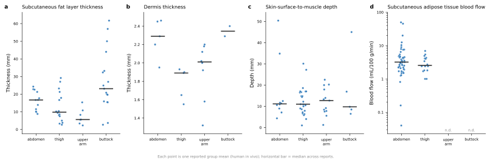

> [!SUMMARY] TL;DR
> 48 PubMed queries → 1,038 abstracts screened → **765 quantitative entries from 208 papers**.
> Fat layer thickness is the dominant site- and patient-dependent parameter (median 5.6 mm upper arm
> to 23.1 mm buttock; study means span 0.7–61.7 mm). Dermis thickness is nearly invariant (1.3–2.5 mm).
> Fat stiffness and adipose blood flow at arm/buttock are the real gaps.

## Scope

Seven parameter families, in the agreed priority order: (1) SC fat layer thickness,
(2) dermis thickness, (3) depth to muscle, (4) injection site, (5) fat blood flow,
(6) site state (lipohypertrophy), (7) fat stiffness.
Evidence rule: human *in vivo*/*ex vivo* primary; preclinical admitted only as a flagged fallback.

## Pooled values by site



| Site | Fat (mm) | Depth to muscle (mm) | Dermis (mm) | Blood flow (mL/100g/min) |
|---|---|---|---|---|
| abdomen | 16.7 | 11.2 | 2.29 | 3.2 |
| thigh | 9.8 | 11.0 | 1.89 | 2.5 |
| upper arm | 5.6 | 12.7 | 2.01 | — |
| buttock | 23.1 | 9.8 | 2.35 | — |

```chart
{"type": "bar", "title": "Median reported thickness by injection site", "caption": "Figure 2. Median of study-level means, human in vivo. Fat thickness varies 4-fold across sites; depth to muscle barely varies.", "data": {"labels": ["abdomen", "thigh", "upper arm", "buttock"], "datasets": [{"label": "SC fat thickness (mm)", "data": [16.7, 9.8, 5.6, 23.1]}, {"label": "Depth to muscle (mm)", "data": [11.2, 11.0, 12.7, 9.8]}, {"label": "Dermis thickness (mm)", "data": [2.29, 1.89, 2.01, 2.35]}]}, "options": {"indexAxis": "y"}}
```

## What this means for the model

> [!FINDING] Fat thickness carries the variability
> Median of reported means runs 5.6 mm (upper arm) → 23.1 mm (buttock), and within-study SD is of the
> same order as the between-site difference. Site and subject variability are not separable — a virtual
> population has to sample both.

- **Dermis thickness** is the tightest family: reported means confined to roughly 1.3–2.5 mm across all
  four sites. Reasonable as a narrow prior, or a fixed value in a first-pass depot model.
- **Depth to muscle** sits at 9.8–12.7 mm median everywhere, but the abdomen and buttock tails reach
  45–50 mm. For needle-length and mis-injection questions the tail is the quantity of interest.
- **Adipose blood flow** spans 0.04–49.8 mL/100 g/min because the corpus mixes basal with post-prandial,
  exercise and vasoactive-challenge states. Basal anchors: abdomen 3.2, thigh 2.6 mL/100 g/min. Read the
  `population` and `covariate_note` columns before reusing any value.

### Site state: lipohypertrophy

101 prevalence entries from 39 papers. Median **45%** of insulin-treated patients (IQR 27–71%,
range 0.2–100%). Ultrasound-based entries median 50% vs palpation/inspection 41% — method shifts the
figure but does not explain the spread, so condition on method and population rather than pooling flat.
Only 12 papers give lesion *geometry*, and just 4 entries carry a usable number.

### Fat stiffness — not yet modellable

> [!CAVEAT] The stiffness values are not commensurable
> Shear-wave elastography gives 1.3–2.9 m/s, or 15–64 kPa after an E ≈ 3ρc² conversion.
> MR elastography gives 1.85 kPa (thigh) and 0.75–1.0 kPa (buttock). The only mechanical-testing
> values are preclinical: rodent uniaxial tension 2.75–4.77 kPa, porcine indentation 0.53 kPa.
> Elastography and quasi-static mechanics measure different things at different strain rates.
> Defensible range from quasi-static/MRE evidence: **~0.5–2 kPa**; treat SWE kPa separately.

## Gaps to close before the model is built

1. **Adipose blood flow at upper arm and buttock** — no entries at all; only abdomen and thigh covered.
2. **Fat stiffness by site and BMI** — one thigh MRE value and one buttock MRE study is the whole human
   quasi-static picture. No abdomen value at depot-relevant strain rates.
3. **Lipohypertrophic tissue properties** — prevalence well characterised, geometry and mechanics not.
4. **Hydraulic conductivity and interstitial pressure of human hypodermis** — searched, no human entries.
   Preclinical fallback will be unavoidable here.
5. **Joint distributions** — nearly every paper reports one parameter marginally. Fat thickness, depth to
   muscle and blood flow are all BMI-dependent and therefore correlated, but no source in this corpus
   reports them jointly in the same subjects. Correlations will have to be imposed via BMI as a latent
   variable.

## Data

- [sc_tissue_parameter_kb.csv](sc_tissue_parameter_kb.csv) — the knowledge base, 765 entries × 29 columns:
  one row per reported value with site, population, covariates, method, evidence tier, QC flag,
  verbatim source phrase, PMID and DOI.
- [sc_parameter_summary_by_site.csv](sc_parameter_summary_by_site.csv) — pooled statistics per parameter × site.
- [sc_tissue_kb_references.csv](sc_tissue_kb_references.csv) — 208 source papers (199 with DOIs).
- [sc_tissue_search_log.csv](sc_tissue_search_log.csv) — all 48 queries with hit counts.

<details>
<summary>Coverage, method and caveats</summary>

### Coverage

| Parameter family | Entries | Papers |
|---|---|---|
| other | 44 | 24 |
| fat layer thickness | 97 | 40 |
| dermis thickness | 55 | 23 |
| depth to muscle | 127 | 46 |
| injection site effect | 98 | 37 |
| fat blood flow | 149 | 52 |
| site state | 153 | 50 |
| fat stiffness | 42 | 16 |

Evidence tiers: 739 human in vivo, 2 human ex vivo, 24 preclinical fallback. Preclinical entries are
confined almost entirely to fat mechanics.

### Method

Three search rounds against PubMed (natural-language → MeSH/boolean → gap-targeted), 48 queries,
1,038 records screened on title + abstract. Records passing the screen (relevant family, numeric content,
priority ≥ 2) were parsed into a fixed schema by a tool-constrained LLM pass instructed to record only
numbers present in the text. Units were normalised in code (all lengths → mm) and range-checked against
physiological bounds per parameter; 4 entries fell outside those bounds and are flagged, not deleted.
Every row keeps a `verbatim` field so any number traces back to its sentence.

### Caveats

Values were extracted from **abstracts**, not full texts. PMC full text existed for only 29 of the 95
highest-priority papers and the extraction budget was exhausted before that pass ran, so per-sex and
per-BMI stratifications present inside those papers are under-represented here. Treat this as a
well-indexed shortlist with values attached, not a completed meta-analysis: confirm each number at its
DOI before it enters the injection model. No risk-of-bias or heterogeneity assessment was performed.

Literature source: PubMed (NCBI). DOIs for all cited articles are in the references file.

</details>
